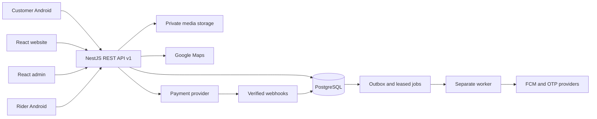

# Complete target architecture

**Stage 3 update:** the owner requested redesign/catalogue tooling before backend implementation. Local category/brand/import/media tools and a matching customer layout are now implemented; 390 PDF concept entries and the 52-node hierarchy are imported; 13 source-reviewed produce photos are bundled, while merchant sales details and 377 exact images remain pending. See stage-3-catalogue.md. Additive SQL/API drafts are not live services.

**Stage 2 update (2026-10-30):** customer/rider Android sources and debug builds, customer React website and admin React workspace now exist as explicit development prototypes. The diagram below remains the target server/provider architecture. Current app flows use isolated synthetic repositories; no real backend/provider capability is inferred. See [current status](status.md), [feature checklist](stage-2-features.md) and [build report](stage-2-build.md).

## System layout

Target design only: Stage 1 executes pure commerce rules. Network services in this diagram are pending.

## Modules and ownership

| Modules | Responsibility |
| --- | --- |
| Auth, users, roles | OTP challenges, sessions, revocation, staff permissions, customer ownership |
| Addresses, zones | Address ownership, house/landmark details, serviceability, versioned zone policy |
| Products, categories, brands | Catalogue, variants, verified media, search and availability |
| Inventory, suppliers | Store stock, reservations, adjustments and stock movements |
| Cart, pricing | Persisted cart, authoritative price/tax records, coupons, versioned rules |
| Orders, items | Idempotent checkout, snapshots, legal transitions, customer history |
| Payments, refunds | Signature checks, webhook deduplication, settlement/refund reconciliation |
| Riders, locations | Approval, availability, offers/assignment, active-task-only location |
| Notifications | Outbox delivery, provider retries, preferences and receipts |
| Campaigns, coupons | Editable dates, eligible collections, usage limits and opt-outs |
| Reviews, support | Verified-order reviews and owned support tickets |
| Reports, admin logs | Actual database aggregates, restricted exports and audit trail |
| Settings | Schema-validated business rules, versions and admin audit |

Use direct application-service calls inside the monolith. Adapters belong at actual database, Maps, OTP, payment, storage and notification boundaries. Domain rules remain framework-independent.

## Android applications

Shared Gradle workspace: customer, rider, core:network, core:database, core:designsystem and core:model. Each app has a separate application ID, signing configuration, permissions and Maps key. Single Activity, Compose Navigation and Material 3; ViewModels expose immutable StateFlow. Repositories orchestrate Retrofit/OkHttp and Room; Hilt supplies dependencies, Coil loads approved product images and Coroutines follow lifecycle cancellation.

Customer navigation: splash → onboarding → phone/OTP → location → home/search/category/product → cart → address/checkout → confirmation/history/tracking → profile/addresses/coupons/notifications/support/privacy. Guest browsing is allowed; ordering needs verified identity. Local drafts survive process death. No offline success claim.

Rider navigation: registration/approval → auth → availability → offers → accepted pickup → pickup confirmation → active delivery → completion → earnings/history. Earnings derive from actual completed assignments and payout rules. Track only during an active task with permissions and the applicable Android foreground-service requirements. Stop on completion, cancellation, logout or permission revocation. Verify current OS/Play requirements during implementation.

## Website and admin

Separate React apps share design tokens and generated API types. Customer routes cover all 16 requested pages. Admin covers catalogue, brands/categories, inventory/suppliers, orders, customers, riders, zones, campaigns/coupons, refunds, reports, audit and settings. Support mobile layouts, labels, keyboard use, visible focus and explicit loading/empty/error/success states.

Admin statistics query actual records. Distinguish GMV, captured receipts, refunds and net receipts; never substitute fictional revenue. Browser authentication uses a same-origin proxy and secure HttpOnly cookies with CSRF protection. Do not store refresh tokens in localStorage.

## Transaction-safe checkout

1. Authenticate; validate address ownership, active zone/store, basket bounds and input schema. Accept variant IDs and quantities, never client prices.
2. Claim (user_id, idempotency_key) and fingerprint the request. A changed body returns 409; an identical retry replays its persisted result.
3. In a bounded transaction, lock settings/coupon and inventory rows in deterministic order. Re-read current catalogue prices and stock availability.
4. Recalculate money; reserve stock and coupon capacity; create order, immutable price/address snapshots, history and outbox atomically. Record settings/quote versions.
5. Commit before calling a provider. Use stable merchant references and reconcile ambiguous timeouts. COD is available only when enabled.
6. Verify online signatures and match amount/currency/reference to server records. Deduplicate webhook events; delayed events cannot undo a later verified state.
7. Confirm eligible orders, finalize stock movements at fulfilment, and release stock/coupon holds exactly once on cancellation/payment expiry. Reconcile payment arriving after expiry; refund if fulfilment is impossible.

PostgreSQL row locks must be combined with atomic updates, bounded retries and consistent ordering. Real database tests must prove last-unit races, coupon limits, idempotency, release and payment races.

## Fulfilment and tracking

Order flow: placed → confirmed → packed → out_for_delivery → delivered; role-controlled cancellation before dispatch. Assignment, payment and refund states are independent. Validate actor, assignment, row version and preconditions in one transaction. Staff cannot fabricate payment verification.

Start with authenticated polling. Location carries recordedAt, accuracy and freshness; show stale/unavailable states. Routes and ETAs require genuine provider results plus preparation/pickup constraints. Zone A is an operational goal, not a guaranteed ten-minute promise. Keep expansion zones disabled until ready.

## Worker and operations

A separate worker claims jobs using FOR UPDATE SKIP LOCKED, leases, attempt counts, bounded exponential retries and dead-letter state. Persist dedupe keys and correlation IDs. Make external calls outside the claim transaction. Crash recovery must be idempotent. Begin with one process and bounded concurrency.

Daily volume targets are planning assumptions, not capacity evidence. Measure peak concurrency, query latency, checkout contention and queue delay before adding replicas/caches/services. Start with one regional API, database, worker and private media store.

Use structured request IDs and outcome/timing logs without OTPs, tokens, addresses or precise locations. Separate liveness/readiness. Deployment needs TLS, least-privilege roles, secret management, backups, restore drills, monitoring, rollback and support ownership. Hosting and recurring spend are undecided.

## Primary references checked 2026-10-30

- [Android architecture](https://developer.android.com/topic/architecture/recommendations)
- [Node TypeScript limits](https://nodejs.org/api/typescript.html)
- [PostgreSQL row locking](https://www.postgresql.org/docs/current/sql-select.html)
- [Maps security](https://developers.google.com/maps/api-security-best-practices)

The architecture is a GROZO design decision informed by these references; they do not certify its implementation.

## Final testing update — 2026-11-01

The target NestJS/PostgreSQL architecture is retained. services/api/server.mjs now supplies a bounded read-only source catalogue testing adapter with explicit 503 commerce errors. Browser catalogue mode optionally fetches it, otherwise identifies bundled data. Native debug builds use bundled catalogue/photo files and expose a configured HTTPS connection check. No cross-app order synchronization exists. Media maps 104 entries; 286 remain pending. See ADR 0005 and final-api.md.
